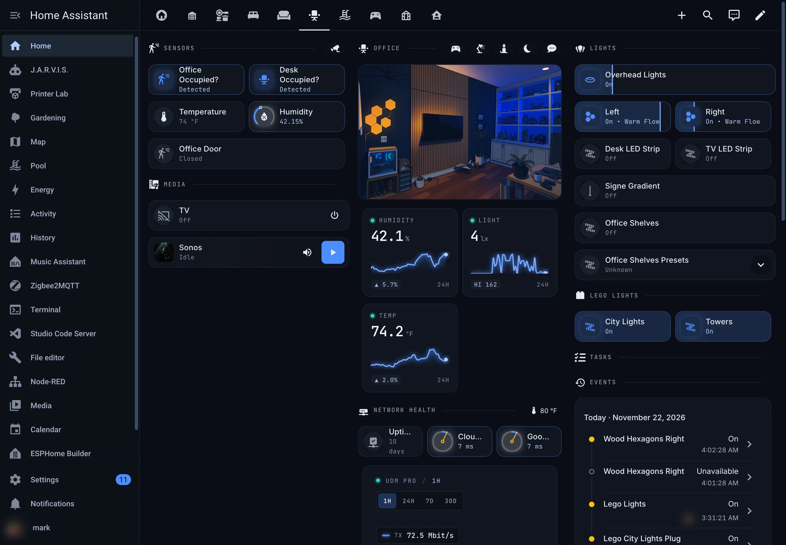
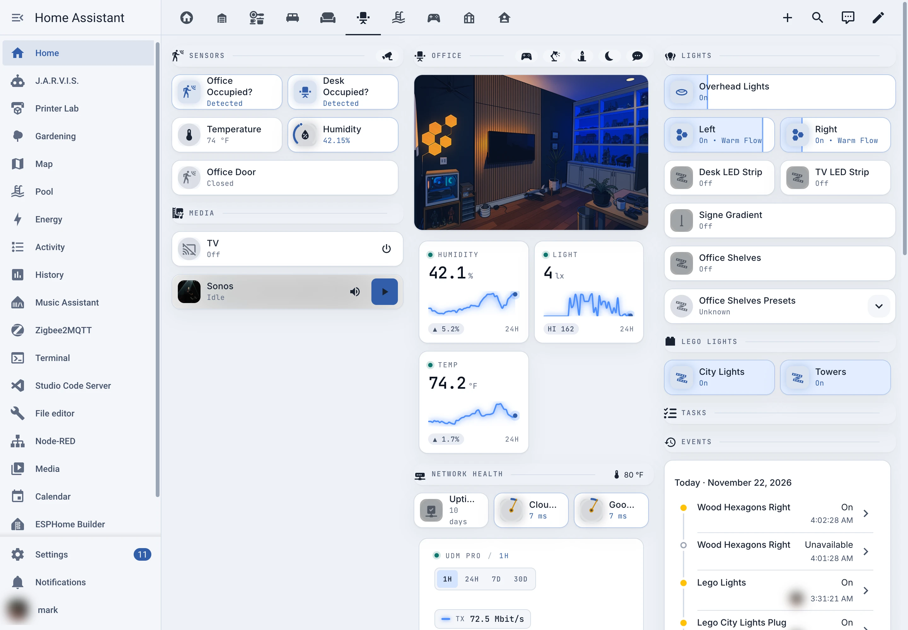
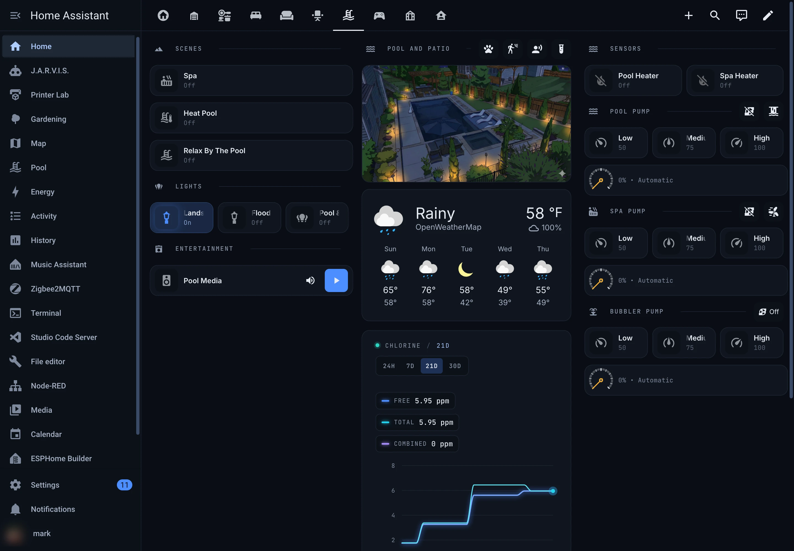
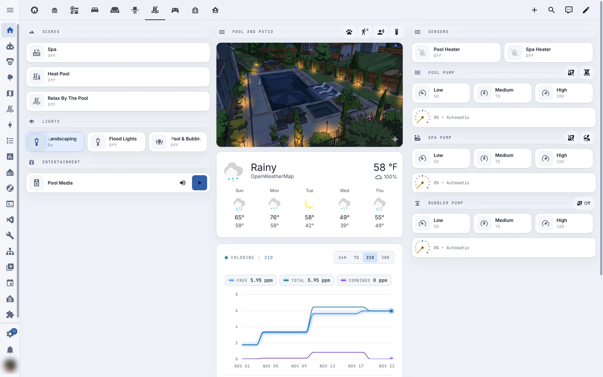
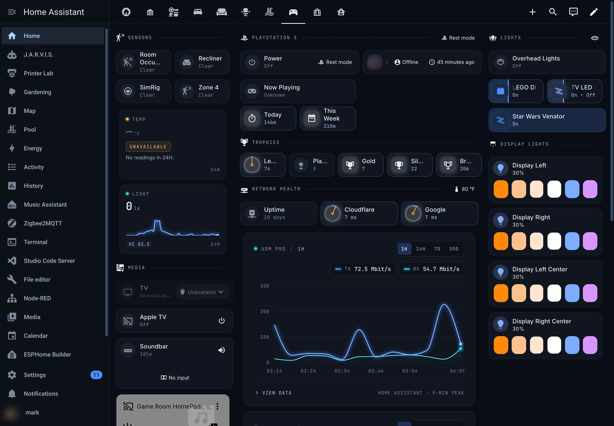
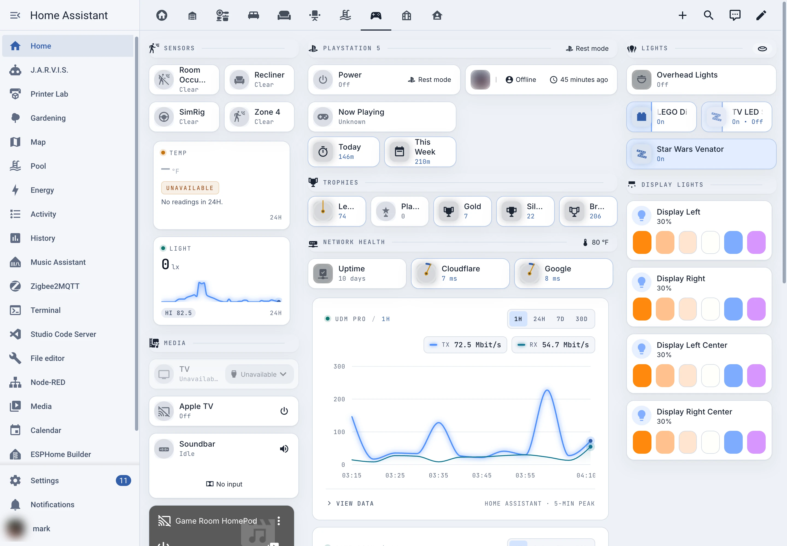
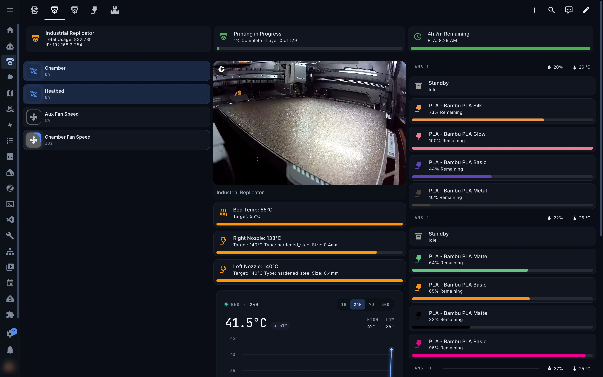
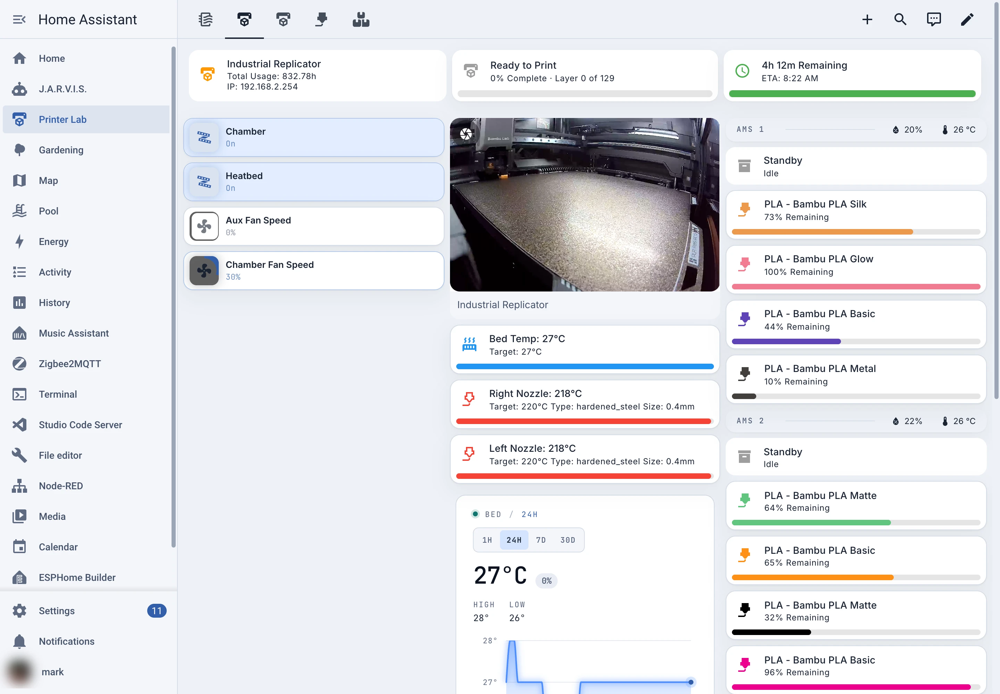
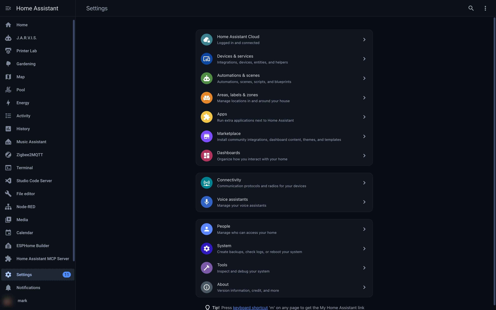
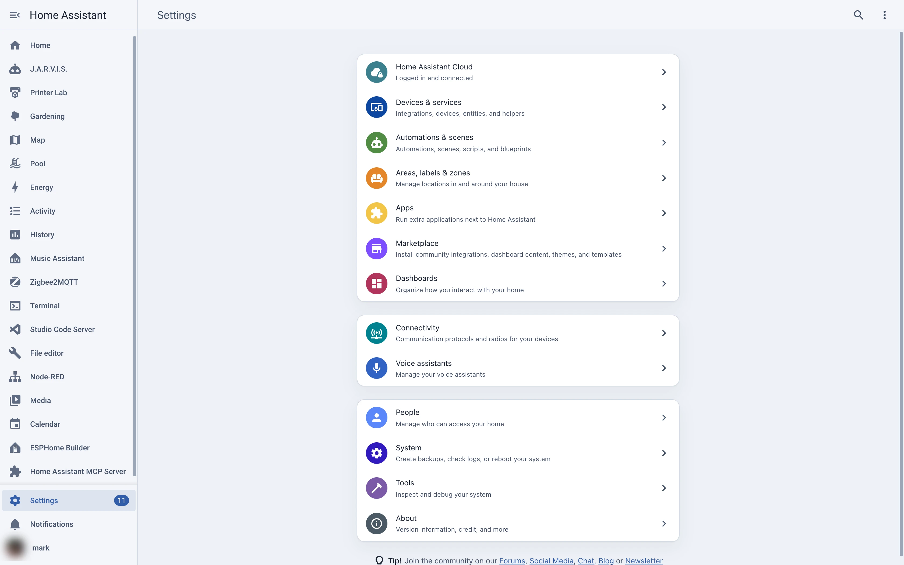

# Instrument

A Home Assistant theme with a dark and a light mode: a quiet navy (or pale) canvas,
calm cards with a 1px line, one blue accent, and small uppercase mono labels, like an
instrument panel.

It styles Home Assistant's own pages and cards, [Bubble Card](https://github.com/Clooos/Bubble-Card)
and [Mushroom](https://github.com/piitaya/lovelace-mushroom), and it comes with an
optional Bubble Card module that finishes the look.

[](https://my.home-assistant.io/redirect/hacs_repository/?owner=markmalek&repository=ha-instrument-theme&category=theme)

## Screenshots

Dark and light, on a real home: Bubble Card buttons and separators with the module,
Home Assistant's own cards, and its sidebar and settings. The charts are a separate
custom card, not part of this theme.

**Office**

 

**Pool**

 

**Game room**

 

**3D printer**

 

**Settings, with the sidebar open**

 

## Install

### With the Marketplace or HACS

1. Click the button above, or add the repository by hand:
   - **Home Assistant 2026.11 and later (Marketplace):** Marketplace → **Add from
     link**, and paste `https://github.com/markmalek/ha-instrument-theme`.
   - **HACS:** ⋮ menu → **Custom repositories**, add the same link with the type
     **Theme**.
2. Open **Instrument** and install it.
3. Make sure themes are switched on in `configuration.yaml`:

   ```yaml
   frontend:
     themes: !include_dir_merge_named themes
   ```

4. Reload themes: the `frontend.reload_themes` action, or restart Home Assistant.

### By hand

Copy [`themes/instrument.yaml`](https://github.com/markmalek/ha-instrument-theme/blob/main/themes/instrument.yaml) to `/config/themes/instrument/`
and reload themes as above.

## Fonts

A theme can't load fonts. Add this as a dashboard resource of type **Stylesheet**
(Settings → Dashboards → ⋮ → Resources) to get Inter and JetBrains Mono:

```
https://fonts.googleapis.com/css2?family=Inter:wght@400;500;600&family=JetBrains+Mono:wght@400;500;600&display=swap
```

Without it the theme falls back to your system fonts.

## Use it

- **Everywhere:** pick **Instrument** as the theme for both modes in your
  [profile](https://my.home-assistant.io/redirect/profile/), or make it the default for
  everyone with the `frontend.set_theme` action (`name: Instrument`, once with
  `mode: light` and once with `mode: dark`).
- **One view:** set the view's theme to `Instrument`.

Leave a view's background image off: the theme's canvas is part of the look. Room
photos work well as picture cards instead.

## Bubble Card module (optional)

Bubble Card draws some things itself that a theme's variables can't reach: a light
slider's fill, an "on" button's fill and its sub-buttons. The module in
[`bubble/instrument.yaml`](https://github.com/markmalek/ha-instrument-theme/blob/main/bubble/instrument.yaml) draws them the Instrument way:

- "on" buttons, sub-buttons and slider fills are a 16% tint of their color (the
  light's own color, or the accent), sliders with a bright edge;
- an "on" icon sits on a tile tinted with its own color;
- the state line is mono, bright when on;
- separators are a small uppercase mono label on a 1px line.

To install it with [Bubble Card Tools](https://github.com/Clooos/Bubble-Card-Tools),
copy the file to `/config/bubble_card/modules/instrument.yaml`. It is global
(`is_global: true`), so every Bubble card gets it; set that to `false` and add
`instrument` to a card's `modules:` to use it on some cards only. Every color in it
falls back to a Home Assistant one, so cards under another theme stay readable.

## For card authors

The theme exports its palette as `--instrument-*` variables (for example
`--instrument-card`, `--instrument-line`, `--instrument-ac`, `--instrument-muted`), in
both modes, so a custom card can match it.

## Contributing

Issues and pull requests are welcome. See [CONTRIBUTING.md](https://github.com/markmalek/ha-instrument-theme/blob/main/CONTRIBUTING.md) for how
the theme is built and tested.

## License

[MIT](https://github.com/markmalek/ha-instrument-theme/blob/main/LICENSE)
